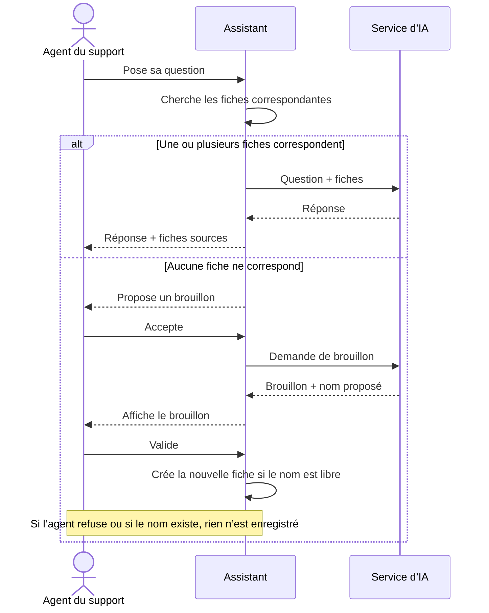

# Besoin : assistant des fiches support
 
## Questions et réponses retenue
| Thème | Question | Réponse retenue |
| --- | --- | --- |
| Utilisateurs | Qui utilise l’assistant ? | Les agents du support, pendant les appels clients. |
| Utilisateurs | Faut-il gérer des droits par utilisateur ? | Non. Seule la clé d’accès au service d’IA est nécessaire. |
| Forme | Quelle forme prend l’assistant ? | Un outil en ligne de commande en Python, relié au service d’IA par la passerelle LiteLLM. |
| Fonctionnement | La réponse cite-t-elle sa source ? | Oui, toujours : le nom du fichier de la fiche utilisée. |
| Fonctionnement | Que fait l’assistant si plusieurs fiches correspondent précisément ? | Il présente la procédure de chacune, avec le nom de chaque fiche source. |
| Fonctionnement | Que fait l’assistant si aucune fiche ne correspond ? | Il le signale, ne donne aucune procédure et propose de rédiger un brouillon de nouvelle fiche. |
| Fonctionnement | Et si la question n’a aucun rapport avec le support ? | Il indique que la question sort du champ du support et ne propose aucun brouillon. |
| Fonctionnement | Le brouillon est-il enregistré directement ? | Non. Il est d’abord affiché à l’agent et n’est enregistré qu’après sa validation. |
| Fonctionnement | L’assistant peut-il modifier ou supprimer une fiche ? | Non. Il peut seulement créer une nouvelle fiche, sous un nom qui n’existe pas encore. Si le nom est déjà pris, il n’enregistre rien. |
| Fonctionnement | Garde-t-il un historique des questions ? | Non. |
| Langue | Dans quelle langue ? | Fiches et interface en français. |
| Limites | Quel délai de réponse ? | Quelques secondes. Au-delà de 30 s sans réponse du service d’IA, l’assistant affiche un message d’erreur au lieu d’attendre. |
| Limites | Faut-il limiter l’usage du service d’IA ? | Oui, par appel : 10 questions et 60 000 jetons au maximum. C’est l’assistant qui compte les jetons. |
| Limites | Taille maximale d’une fiche ? | 20 ko. |
| Disponibilité | Quand l’assistant est-il disponible ? | Du lundi au samedi, de 9 h à 17 h. En dehors de ces horaires, il refuse les questions. |
| Accessibilité | Quels besoins ? | Un technicien non-voyant utilise l’outil : une utilisation vocale est demandée. Pas d’autre handicap à prendre en compte. |
 
Hypothèses :
 
- Une session de l’assistant = un appel client pour les limites de 10 questions et de 60 000 jetons.
- La limite de 20 ko porte sur la lecture ?

## Parcours
 
Acteurs : l’**agent du support**, l’**assistant** (outil en CLI qui accède au dossier des fiches) et le **service d’IA** de l’entreprise (passerelle LiteLLM).
 
| Étape | Qui | Fait quoi |
| :---: | --- | --- |
| 1 | Agent du support | Pose sa question en français pendant l’appel |
| 2 | Assistant | Cherche dans le dossier des fiches celles qui correspondent à la question |
| **A** | | **Une ou plusieurs fiches correspondent** |
| 3A | Assistant | Transmet la question et les fiches au service d’IA |
| 4A | Service d’IA | Rédige la réponse à partir de ces fiches uniquement |
| 5A | Assistant | Affiche la réponse et le nom de chaque fiche source |
| **B** | | **Aucune fiche ne correspond à une question liée au support** |
| 3B | Assistant | Indique qu’aucune fiche ne couvre la question et propose un brouillon |
| 4B | Agent du support | Accepte la proposition ; s’il refuse, le parcours s’arrête |
| 5B | Assistant | Demande un brouillon au service d’IA |
| 6B | Service d’IA | Rédige le brouillon (Symptôme, Étapes, Vérification) et propose un nom de fichier |
| 7B | Assistant | Affiche le brouillon et le nom de fichier proposé |
| 8B | Agent du support | Valide ou refuse l’enregistrement |
| 9B | Assistant | Si l’agent valide et que le nom est libre, crée la nouvelle fiche. Si une fiche porte déjà ce nom, l’indique et n’enregistre rien. Si l’agent refuse, n’enregistre rien |
 

 
## User stories
 
> **US1 — En tant qu’**agent du support en appel avec un client, **je veux** obtenir la procédure tirée de nos fiches avec sa source, **afin de** répondre au client sans chercher la fiche pendant l’appel.
 
> **US2 — En tant qu’**agent du support, **je veux** qu’un brouillon de fiche me soit proposé quand aucune fiche ne couvre ma question, **afin de** compléter nos fiches sans passer une demi-heure à les rédiger.
 
## Critères d’acceptation
 
| # | US | Situation *Étant donné…* | Action *Quand…* | Résultat attendu *Alors…* |
| :---: | :---: | --- | --- | --- |
| 1 | 1 | Une fiche correspondant à la question existe dans le dossier des fiches | L’agent pose sa question | La réponse reprend les étapes de la fiche et cite son nom de fichier comme source |
| 2 | 1 | Deux fiches correspondent précisément à la question | L’agent pose sa question | La réponse présente la procédure de chaque fiche et cite le nom de chacune |
| 3 | 1 | Une fiche liée à la question dépasse 20 ko | L’agent pose sa question | Un message indique que cette fiche dépasse 20 ko et n’est pas utilisée ; aucun brouillon n’est proposé |
| 4 | 1 | La question n’a aucun rapport avec le support | L’agent pose sa question | Un message indique que la question sort du champ du support ; aucune procédure ni aucun brouillon n’est proposé |
| 5 | 2 | Aucune fiche ne correspond à une question liée au support | L’agent pose sa question | Un message indique qu’aucune fiche ne couvre la question ; aucune procédure n’est affichée ; un brouillon est proposé |
| 6 | 2 | Un brouillon est affiché avec un nom de fichier libre | L’agent valide l’enregistrement | Une nouvelle fiche en français, avec les sections Symptôme, Étapes et Vérification, apparaît dans le dossier des fiches ; aucun autre fichier n’est créé ni modifié |
| 7 | 2 | Un brouillon est affiché | L’agent refuse l’enregistrement | Aucun fichier n’est créé ni modifié |
| 8 | 2 | Le nom de fichier proposé correspond à une fiche existante | L’agent valide l’enregistrement | Un message indique qu’une fiche porte déjà ce nom ; aucun fichier n’est créé ; la fiche existante n’est pas modifiée |
| 9 | 1, 2 | Le service d’IA ne répond pas | L’agent pose sa question | Au bout de 30 s, un message d’erreur s’affiche et l’assistant accepte une nouvelle question |
| 10 | 1, 2 | 10 questions ont déjà été posées pendant la session | L’agent pose une 11ᵉ question | Un message indique que la limite de questions est atteinte ; aucune réponse n’est produite |
| 11 | 1, 2 | L’assistant a compté 60 000 jetons échangés pendant la session | L’agent pose une nouvelle question | Un message indique que la limite de la session est atteinte ; aucune réponse n’est produite |
| 12 | 1, 2 | Nous sommes un dimanche, ou en semaine avant 9 h ou après 17 h | L’agent pose une question | Un message indique que l’assistant est disponible du lundi au samedi, de 9 h à 17 h ; aucune réponse n’est produite |
 
## Objectifs d’accessibilité
 Un technicien non-voyant utilise l’outil : une utilisation vocale est demandée. Pas d’autre handicap à prendre en compte.