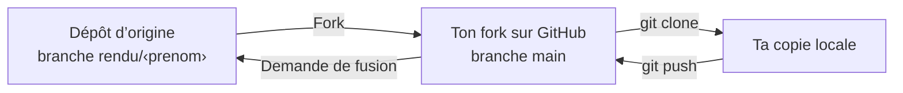

# Fork et demande de fusion sur GitHub

Tu travailles dans ton fork, une copie du dépôt sur ton compte GitHub. Tu rends ton travail par une demande de fusion (Pull Request) de la branche `main` de ton fork vers ta branche `rendu/<prenom>` du dépôt d’origine.

Le clone, les commits et le push se font avec Git, dans ton terminal : voir [Commandes Git](git-commandes.md).

## Forke le dépôt

Sur la page du [dépôt d’origine](https://github.com/SIMPLON-DIST-DEVIA-P1-199833/assistant-fiches-support), clique sur **Fork**, choisis ton compte comme **Owner**, puis clique sur **Create fork**.

## Ouvre ta demande de fusion

Une fois ton premier commit poussé dans ton fork :

1. Sur la page du [dépôt d’origine](https://github.com/SIMPLON-DIST-DEVIA-P1-199833/assistant-fiches-support), ouvre l’onglet **Pull requests**, puis clique sur **New pull request**.
2. Clique sur **compare across forks**, puis règle les quatre listes :
   - **base repository :** `SIMPLON-DIST-DEVIA-P1-199833/assistant-fiches-support` ;
   - **base :** `rendu/<prenom>`, ta branche ;
   - **head repository :** `<ton-compte>/assistant-fiches-support` ;
   - **compare :** `main`.
3. Vérifie que seuls tes changements apparaissent, donne un titre, puis clique sur **Create pull request**.

Chaque nouveau `git push` sur `main` de ton fork met à jour ta demande de fusion : inutile d’en ouvrir une autre.

## Relis la demande de fusion d’un pair

1. Dans l’onglet **Pull requests** du dépôt d’origine, ouvre la demande de fusion de ton pair, puis l’onglet **Files changed**.
2. Survole une ligne et clique sur l’icône **+** à côté de son numéro, écris ton commentaire, puis clique sur **Start a review** (ou **Add review comment** pour les suivants).
3. Clique sur **Review changes**, écris un commentaire de synthèse, choisis **Comment**, puis clique sur **Submit review**. Tes commentaires restent invisibles pour ton pair jusqu’à cette étape.

## Copie le lien d’un commit

Sur la page de ton fork, clique sur **Commits**, puis sur le message du commit. Copie l’adresse de la page, de la forme `https://github.com/<ton-compte>/assistant-fiches-support/commit/<identifiant>`.
